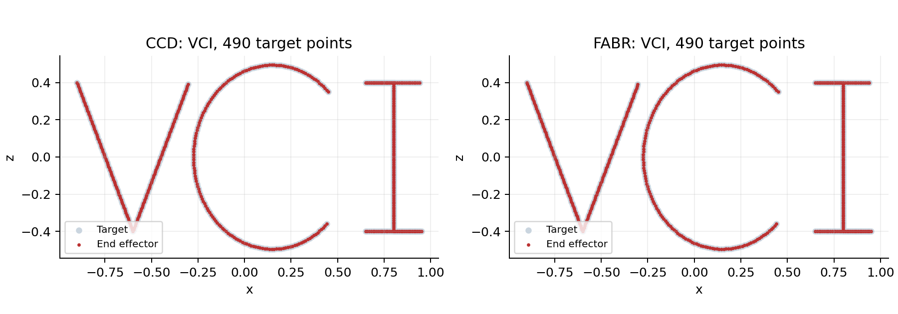
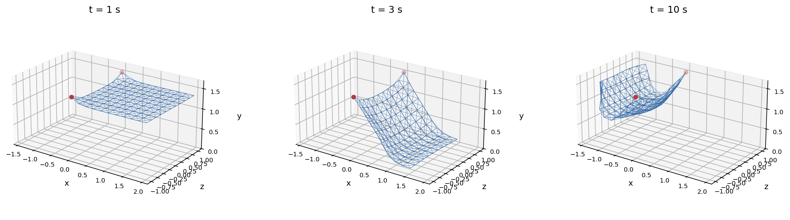

# Lab 4：Animation

## 1. 实现

源代码：`src/VCX/Labs/4-Animation/tasks.cpp`。完成全部必做；未做两个 bonus。

### 1.1 前向运动学

设局部旋转为 \(q_i\)、局部位移为 \(o_i\)，全局旋转、位置为 \(Q_i,p_i\)：

\[
Q_0=q_0,\quad p_0=o_0,\qquad
Q_i=Q_{i-1}q_i,\quad p_i=p_{i-1}+Q_{i-1}o_i.
\]

从 `StartIndex` 向末端递推；从 0 开始时先更新根关节。

### 1.2 CCD

每轮从末端的父关节向根关节遍历。构造“关节→末端”到“关节→目标”的世界旋转 \(\Delta Q_i\)，再更新：

\[
q_i=Q_{i-1}^{-1}\Delta Q_iQ_i
\]

根关节直接取 \(q_0=\Delta Q_0Q_0\)，每次更新后重新计算后续 FK。

方向旋转用归一化四元数 \((1+a\cdot b,a\times b)\)，保留小角度精度；反向共线时使用 GLM 的旋转构造。零方向不参与当前关节更新。初始链与目标共线且仍有误差时，对第二个关节施加 0.01 rad 扰动，打破直链奇异姿态。

### 1.3 FABR

每轮先固定末端到目标，向根部按原骨长投影；再恢复根位置，向末端投影。投影中两点重合时沿用该段上一轮的方向。最后由骨骼方向恢复全局旋转，再转换为局部旋转。

若根到目标的距离不小于总骨长，直接将整条骨链沿目标方向伸直。

### 1.4 自定义轨迹

图案为 **VCI**，共 490 个点，位于 \(y=0\) 平面。V、I 用线段采样，C 用椭圆弧采样；字母间直接切换目标，不生成连接线上的采样点。

### 1.5 弹簧质点系统

121 个质点、618 根弹簧；初始网格 2×2、间距 0.2，固定同侧两个角。所有质点质量相同，弹簧使用统一刚度与轴向相对速度阻尼。

对弹簧两端 \(i,j\)，令 \(d=x_j-x_i\)、\(r=\|d\|\)、\(e=d/r\)、\(w=v_j-v_i\)：

\[
f_i=[k(r-L)+c(e^Tw)]e,\qquad f_j=-f_i.
\]

采用每帧一次的线性化隐式 Euler，未知量为速度增量：

\[
(M-hJ_v-h^2J_x)\Delta v=hf+h^2J_xv,
\qquad v^{n+1}=v^n+\Delta v,\quad x^{n+1}=x^n+hv^{n+1}.
\]

令 \(E=ee^T\)，单根弹簧的刚度与阻尼块取

\[
K=k\left[E+\max(0,1-L/r)(I-E)\right],\qquad C=cE.
\]

矩阵对角块加 \(hC+h^2K\)，交叉块加其负值。受压时将负的切向刚度截为 0；阻尼方向冻结在当前状态，忽略其位置导数。上述两项是线性化近似，不做完整非线性 Newton 迭代。

固定点速度为零，固定自由度行列取单位约束，保留固定—自由弹簧对自由端的力与对角块。全局稀疏矩阵用 `SimplicialLLT` 求解。每帧 1 步，未沿用原先 1000 子步。

## 2. 实验设置

- CPU：Intel Core Ultra 7 258V；Windows x64。
- 应用构建：`xmake build -y lab4`，MSVC 2022、Release，通过。
- 数值实验：GCC 15.1.0，`-std=c++20 -O2 -DNDEBUG`；GLM 1.0.0、Eigen 5.0.1，单精度。
- 实验代码：[experiment.cpp](experiment.cpp)；原始输出：[experiment-results.txt](experiment-results.txt)。实验直接链接作业实现与 `IKSystem.cpp`。
- IK：误差阈值 \(10^{-4}\)，最多 100 轮；CCD 一次完整关节遍历、FABR 一次双向投影各计 1 轮。
- 单目标实验均从同一初始直链开始。通过依次增加迭代上限确定首次达标的轮数；轨迹实验以上一个目标求解结果作为下一个目标的初态。
- 下列效果图由程序输出的目标、末端和质点坐标绘制，非窗口截图。

## 3. IK 结果与问题回答

### 3.1 迭代次数比较（Question 2）

根位置 \((0,1.7,0)\)，骨长依次为 0.8、0.4、0.2、1.2，总长 2.6。

| 目标位置 | CCD 轮数 | CCD 末端误差 | FABR 轮数 | FABR 末端误差 |
|---|---:|---:|---:|---:|
| (0.6, 0, 0.3) | 18 | 6.368e-5 | 5 | 3.683e-5 |
| (1.6, 0.2, 0.2) | 31 | 8.154e-5 | 13 | 7.636e-5 |
| (2.2, 0.6, 0.8) | 100，未达标 | 3.136e-2 | 100，未达标 | 2.463e-3 |
| (0, 0, 0)，共线初态 | 73 | 8.965e-5 | 3 | 5.608e-6 |
| (3, 0, 0)，不可达 | 100 | 8.48194e-1 | 直接伸直 | 8.48188e-1 |

本组达标案例中 FABR 所需轮数更少。接近最大伸展边界时两者均收敛较慢；同样 100 轮下 FABR 残差更小。迭代次数与目标及初态有关。

### 3.2 轨迹误差

| 轨迹 | 点数 | CCD 最大末端误差 | FABR 最大末端误差 |
|---|---:|---:|---:|
| circle | 150 | 9.983e-5 | 9.850e-5 |
| square | 150 | 9.994e-5 | 9.964e-5 |
| heart | 150 | 9.992e-5 | 9.952e-5 |
| triangle | 150 | 9.999e-5 | 9.986e-5 |
| star | 400 | 9.983e-5 | 9.997e-5 |
| VCI | 490 | 9.997e-5 | 9.956e-5 |

所有轨迹点均达到阈值；最大骨长绝对误差 2.385e-7。VCI 平均末端误差：CCD 为 8.102e-5，FABR 为 2.316e-5。

### 3.3 不可达目标（Question 1）

目标距根超过总骨长时，末端误差不能降到零。CCD 继续迭代至上限；FABR 直接沿根—目标方向伸直。上述目标 \((3,0,0)\) 的距离下界为

\[
\sqrt{3^2+1.7^2}-2.6\approx0.848188.
\]

两种算法的实测末端误差均接近这个下界，骨长与根位置保持不变。

### 3.4 减少抖动（Question 3，选做思路）

以上一帧姿态初始化；优先选择接近上一帧的解，或限制单帧旋转变化。也可对四元数做插值平滑，但会引入跟踪延迟。本实现保留上一帧姿态，没有额外加入平滑或关节限位。

## 4. 布料结果

每组模拟 10 s。表中耗时为推进、状态统计和 CSV 输出合计平均时间，不含渲染；为单次运行结果。

| 场景 | 质量 m | 刚度 k | 阻尼 c | 重力 g | 步长 h | 帧数 | 平均 ms/帧 | 最大长度/静止长度 | 最终中心高度 |
|---|---:|---:|---:|---:|---:|---:|---:|---:|---:|
| 默认 | 1 | 100 | 0.2 | 0.3 | 1/60 | 600 | 1.069 | 1.643 | 0.7393 |
| 高刚度、低阻尼 | 0.5 | 300 | 0.1 | 1 | 1/30 | 300 | 0.822 | 1.391 | 0.4680 |
| 高质量、低刚度 | 10 | 10 | 10 | 0.1 | 1/30 | 300 | 1.071 | 8.410 | -2.3565 |

三组所有位置均有限，固定点最大位移均为 0。第三组弹簧很软、负载较大，发生明显拉伸，不能将数值有限等同于布料不可伸长。

原 1000 子步版本在默认参数下推进 120 帧，平均 3.055 ms/帧；该基线仅计推进、不含 CSV 与状态统计。

### 4.1 解析对照与几何检查

| 检查 | 设置 | 实测结果 |
|---|---|---|
| 自由落体隐式步 | 单点，g=0.3，h=0.1，初始位置速度为 0 | vy=-0.0300000，y=-0.00300000 |
| 单弹簧隐式步 | 固定左端，m=1、k=100、L=1、x=1.2、v=0、g=c=0，h=0.1 | x=1.1000000，v=-1.0000002；理论 1.1、-1 |
| FK 根旋转 | 根绕 z 轴旋转 90° | 末端为 (2.6,1.7,0)，误差小于 2e-6 |
| FK 局部更新 | 从关节 2 更新，与完整更新比较 | 位置差小于 1e-6 |
| CCD 共线初态 | 根旋转 90° 后的共线目标 | 达到 1e-4 阈值 |
| FABR 重合投影 | 目标取已有倒数第二关节的位置 | 数值有限，骨长误差小于 3e-6 |

原始输出中所有检查均为 PASS。

## 5. 复现实验

在仓库根目录编译 `reports/lab4/experiment.cpp`、`src/VCX/Labs/4-Animation/tasks.cpp`、`src/VCX/Labs/4-Animation/IKSystem.cpp`，指定 `src/VCX`、GLM 和 Eigen 头文件目录。运行时第一个参数为数据输出目录，例如 `build/lab4-tests`，该目录需先存在；将标准输出保存到同目录 `results.txt`。

生成图片：`python reports/lab4/plot.py`，依赖 NumPy、Matplotlib。实验数据保存在 `build/lab4-tests`，不提交构建产物。
